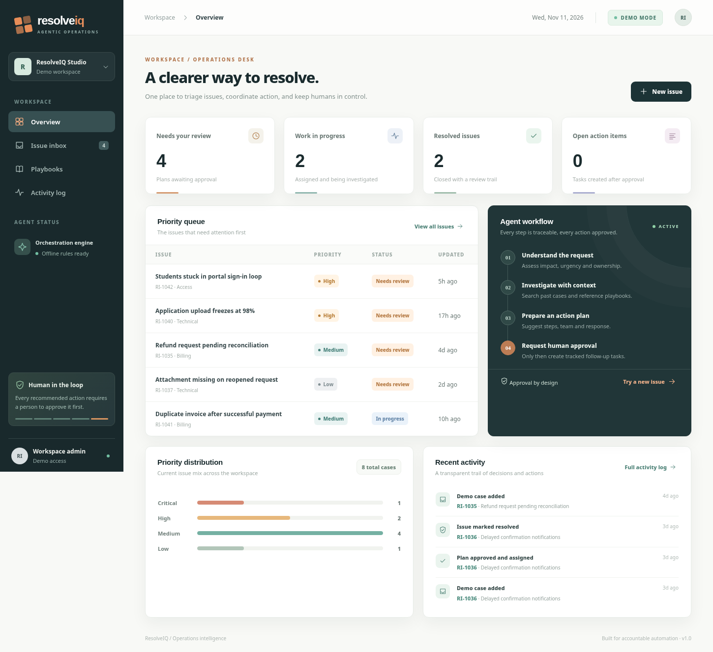

# ResolveIQ

**From incoming issues to accountable action.** A complete, locally runnable agentic issue-management MVP built for the Agentic Hackathon.



[Watch the 30-second product walkthrough](media/resolveiq_demo.mp4) · [See the analysis drawer](media/issue_analysis.png)

ResolveIQ demonstrates how an operations team can receive an issue, search institutional context, propose a resolution plan, and hand the decision to a human reviewer. Only after approval does the software create actionable internal follow-up tasks, which can be tracked to resolution.

## Quick start

Requires Python 3.10+. On Windows, double-click **START_WINDOWS.bat** if Python is installed, or run the commands below.

```bash
pip install -r requirements.txt
uvicorn app:app --reload
```

Open **http://localhost:8000**. The SQLite database is created automatically with **8 labeled demo cases and 6 playbooks**. No API keys needed to try the core product. To reset demo data, stop the app, delete `data/resolveiq.db`, then restart.

## Automatic local Qwen2.5 AI — Ollama with offline fallback (v1.2)

ResolveIQ **automatically detects** a running local Ollama server and the installed `qwen2.5:3b` model. If both are present, **new issues get real Qwen-generated planning** grounded in playbooks and similar issues. Their recorded source is **Ollama · qwen2.5:3b**. Nothing is executed automatically: human approval is still required.

If Ollama is stopped, the model has not been downloaded, a request times out, or inference fails, the app automatically uses its **offline rules workflow**, recording **Offline rules · fallback** for that issue. The clickable badge in the top bar shows the current model availability. No paid API is needed.

**Windows:** Install Ollama from https://ollama.com/download, double-click `INSTALL_QWEN_WINDOWS.bat` (downloads about 1.9 GB on first use), then run `START_WINDOWS.bat`. The Qwen model can run offline after downloading. Instructions: **[AI_SETUP_WINDOWS.md](AI_SETUP_WINDOWS.md)**.

**Linux / macOS:** Run `ollama pull qwen2.5:3b`, ensure the Ollama daemon is running, then start FastAPI normally. No opt-in environment variable is needed. Optional `.env` settings are in `.env.example` (`LLM_MODE=auto` by default).

**Important for judges:** A cloud demo on Render without Ollama on the **same server** intentionally uses **Rules fallback**. Local Ollama running on the developer's laptop cannot be reached from a hosted app automatically. The model-connected feature can be demonstrated on the local machine; do not label a rules-only hosted demo as running Qwen.

## End-to-end demo (90 seconds)

1. From the dashboard, click **New issue**.
2. Choose **Portal access** or **Payment problem** under sample scenarios, then click **Analyze issue**.
3. Inspect the details drawer: category, urgency, team routing, agent execution trace, past-case search, matching playbooks, proposed steps, and drafted reply.
4. Click **Approve & assign**. This creates internal tasks and moves the issue to **In progress**.
5. Check the tasks, then click **Mark resolved**. Open **Activity log** to see the full audit trail.

Try **Security alert** to see routing and prioritization change.

## Architecture

```text
Browser (responsive HTML / CSS / JavaScript)
  └─ FastAPI REST endpoints
      ├─ Issue intake and persisted audit events
      ├─ Triage classifier (offline fallback)
      ├─ Similar case retrieval (token overlap / Jaccard)
      ├─ Playbook retrieval (local SQLite knowledge base)
      ├─ Resolution planning (automatically selected local Qwen2.5 through Ollama)
      └─ Human approval gate
          ├─ Approved → create and assign internal tasks
          └─ Rejected → record decision and allow reanalysis
                 └─ SQLite persistence
```

The orchestrator invokes explicit tools for classification, retrieval, playbook grounding, planning and approval. An LLM can make bounded planning decisions; permitted teams and categories are validated before being saved. Both LLM and deterministic modes use the same auditable workflow. User-provided issue text is treated as untrusted data in model prompts.

## API

- `GET /api/health` — service status and engine mode.
- `GET /api/dashboard` — actual counts from local data.
- `GET /api/issues` / `GET /api/issues/{id}` — filter and inspect issue records.
- `POST /api/issues` — create issue and run the complete plan workflow.
- `POST /api/issues/{id}/approve` / `reject` / `reanalyze` — human decision.
- `PATCH /api/issues/{id}` — update workflow state / resolve.
- `PATCH /api/tasks/{id}` — complete or reopen internal tasks.
- `GET /api/playbooks` / `GET /api/activity` — knowledge and audit records.
- Interactive API docs: `/docs`.

## Deploy a public demo

A `render.yaml` is included for Render's Python web-service deployment. See [DEPLOY.md](DEPLOY.md). Data may be ephemeral on a free hosting plan, so this deployment is intended for **demo issues only**. Local SQLite is persistent unless deleted.

## Scope and trust

This is a hackathon **prototype, not a production helpdesk**. It intentionally has no login/authentication or email/sensitive external-system integrations. Do **not** process real personal, billing or security incident details on an unauthenticated public demo. In this release, approvals create tracked internal tasks; they do not send messages, issue refunds, reset passwords or change production services. This protects users from unreviewed automation.

**Technology:** Python, FastAPI, SQLite, vanilla JavaScript, CSS. No frontend build tooling or paid services required.

## Hackathon submission

Use [DEVPOST_SUBMISSION.md](DEVPOST_SUBMISSION.md) for the submission narrative, demo outline, and truthful feature claims.


## UI interaction improvements (v1.1)

- **Workspace dropdown:** Choose Overview, Issue inbox, or New issue. It is a single demo workspace rather than a multi-workspace switcher.
- **Issue inbox badge:** Counts **unseen issues requiring review**, not all issues. Opening the inbox marks currently listed issues as seen; viewing an individual issue marks that issue as seen. This notification state is kept in the **current browser's localStorage**, independently of issue status and SQLite. New issues can produce a new badge. Clearing a badge does **not** approve or resolve an issue.
- **Account menu:** Click `RI` in the header to see the demo identity and quick links. No sign-in/logout is available in this demo.
- **Demo Mode:** Click the badge for a transparent description of the environment. Initial data is simulated, but issue CRUD, internal approval tasks and activity logs persist locally in SQLite. Qwen via local Ollama is auto-detected; offline rules are used if it is unavailable.
- **Human in the loop:** A compact approval policy button in the header remains accessible when zoom or a narrower viewport hides the sidebar callout.
